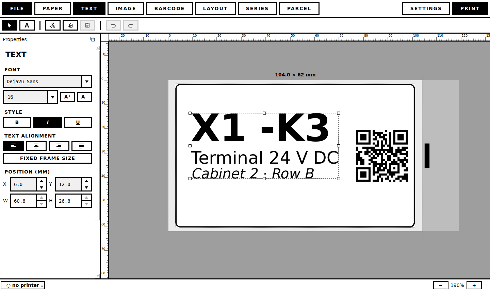
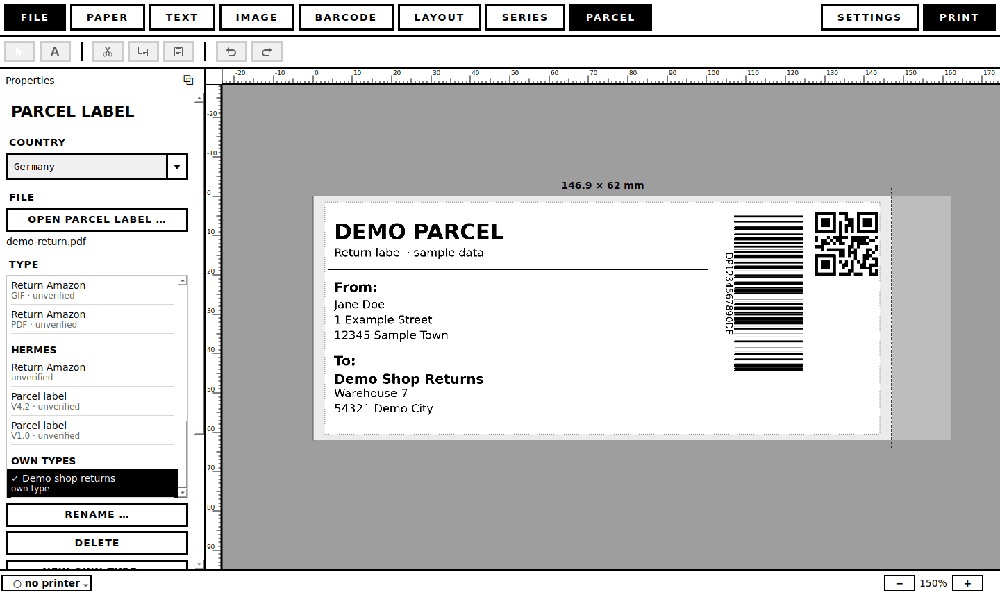
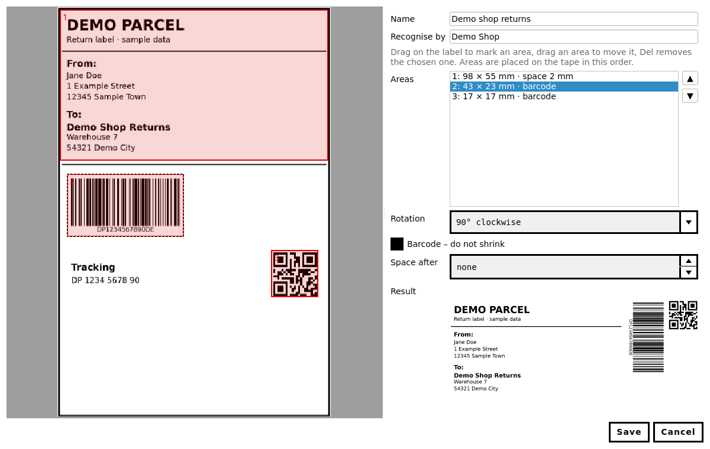

<p align="center">
  
</p>

<h1 align="center">labelwerk</h1>

<p align="center">
  <b>Design and print labels on Brother QL label printers under Linux.</b><br>
  Text, images, symbols, barcodes and series on a label shown in real size – plus parcel labels
  converted for the label printer. No P-touch Editor, no Wine.
</p>

<p align="center">
  <a href="https://github.com/siN161/labelwerk/releases/latest"></a>
  <a href="https://github.com/siN161/labelwerk/releases/latest"></a>
  <a href="#installation"></a>
</p>

<p align="center">
  <a href="https://github.com/siN161/labelwerk/releases/latest">Download</a> ·
  <a href="#installation">Installation</a> ·
  <a href="#printers">Printers</a> ·
  <a href="#parcel-labels">Parcel labels</a> ·
  <a href="#translations">Translations</a> ·
  <a href="https://github.com/siN161/labelwerk/issues">Report a printer</a>
</p>

<p align="center">
  <a href="https://github.com/siN161/labelwerk/actions/workflows/tests.yml"></a>
  <a href="https://github.com/siN161/labelwerk/releases/latest"></a>
  <a href="LICENSE"></a>
  
  
</p>

---

- Text with per-character formatting, images (PNG, JPG, SVG, PDF pages, screenshots), symbols, barcodes and QR
  codes, decorative frames – placed freely on a label shown in real size
- Series from CSV/Excel or numbering, favourites, `*.labelwerk` files
- Parcel labels (DHL, Hermes, Amazon returns) converted for 62 mm tape or 4×6" labels
- Prints PDFs and images 1:1 (e.g. postage stamps), also from the command line
- English and German



## Printers

| Status | Printers |
|---|---|
| **tested** | QL-600 with DK-22205 (62 mm continuous), USB |
| should work (untested) | QL-500/550/560/570/580N/650TD/700/710W/720NW/800/810W/820NWB, QL-1050/1060N/1100/1110NWB/1115NWB (102 mm) – USB or network |
| untested | red/black printing (QL-8xx with DK-22251), Zebra printers via ZPL (USB/network), any label printer set up in CUPS (e.g. Dymo LabelWriter) |
| not supported | P-touch tape printers (PT-…), Bluetooth printers |

The printer model is detected automatically (`labelwerk printers`). Tried an untested model? Please open an issue
with model, label roll and result.

## Installation

```bash
git clone https://github.com/siN161/labelwerk.git
cd labelwerk
python3 -m venv .venv && source .venv/bin/activate
pip install -e ".[gui]"
labelwerk install-desktop          # adds labelwerk to the app launcher
sudo usermod -aG lp "$USER"        # printer access without root, then log in again
```

On the QL-600 the **Editor Lite LED must be off**, otherwise it shows up as a USB drive.

## Usage

Start the app with `labelwerk-gui` (or from the launcher). The command line covers the basics:

```bash
labelwerk print "X1 -K3\nTerminal 24V" -l 62x29 --preview preview.png
labelwerk print "Shelf 4" -l auto                  # label from the loaded roll
labelwerk print-file stamp.pdf -l 62               # PDF/PNG/JPG 1:1
labelwerk parcel label.pdf -l 62                   # convert a parcel label
labelwerk printers                                 # detected printers and supported models
labelwerk labels                                   # labels of the printer
```

`labelwerk --help` and `labelwerk <command> --help` list all options.

## Parcel labels

Open a parcel label in the **PARCEL** tab (or `labelwerk parcel`): the type is recognized, the label is cut into
pieces and arranged on the tape – barcodes at full size. DHL domestic is tested on real labels; the other types are
measured from sample sheets and marked *untested*. You can draw your own types on any label. Always check that the
barcodes scan before shipping.





## Translations

Translations are welcome – see [`src/labelwerk/po/README.md`](src/labelwerk/po/README.md).

## Development

```bash
pip install -e ".[dev]"
QT_QPA_PLATFORM=offscreen pytest -q
```

Tests never talk to a printer. The core (`src/labelwerk/*.py`) has no Qt dependency; `gui/` only displays and edits.

## License

GPL-3.0-or-later. Uses [brother_ql-inventree](https://github.com/matmair/brother_ql-inventree) (GPLv3+),
[PySide6](https://doc.qt.io/qtforpython/) (LGPL), [segno](https://github.com/heuer/segno) (BSD-3-Clause) and more;
symbol licenses in [`src/labelwerk/clipart_data/LICENSES.md`](src/labelwerk/clipart_data/LICENSES.md).
